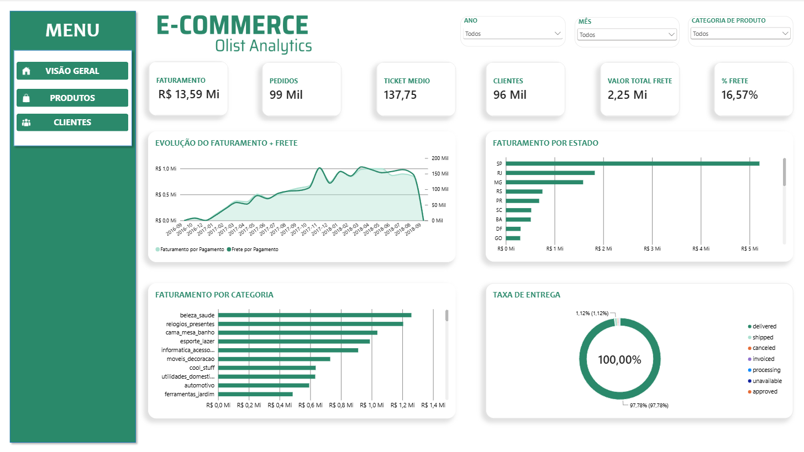
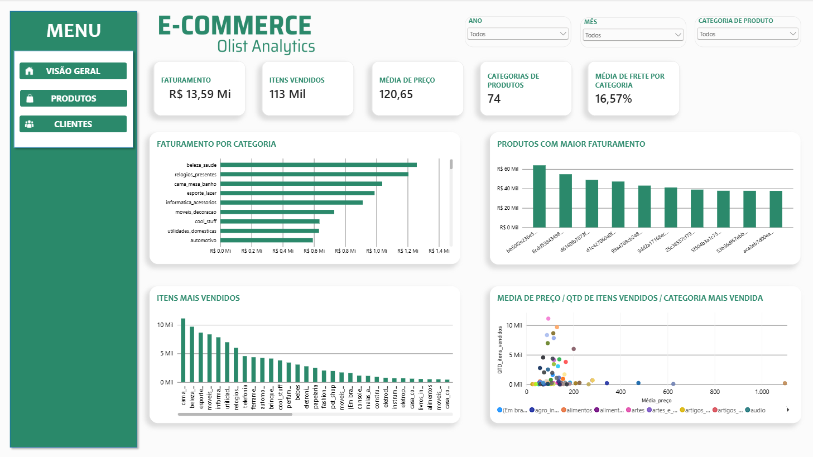
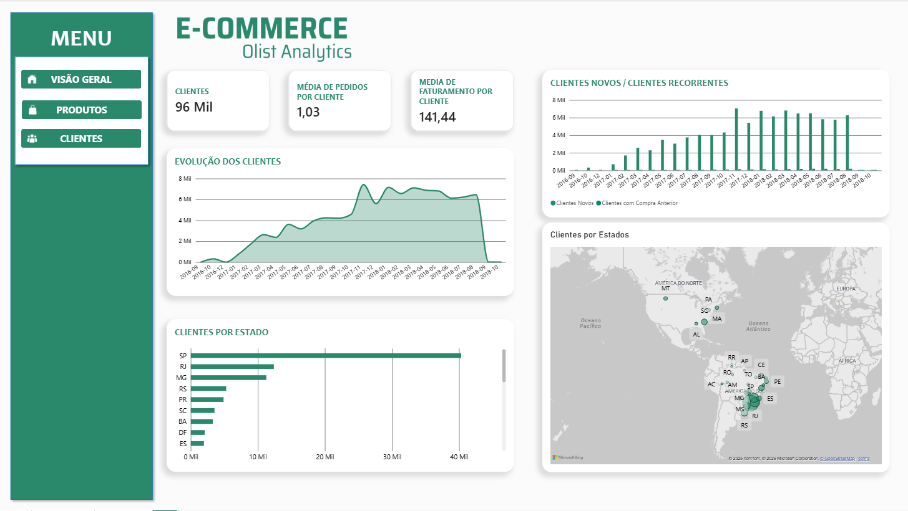

E-commerce | Inteligência Comercial — Olist

Projeto de portfólio desenvolvido para analisar dados de e-commerce e transformar informações em indicadores para apoiar a tomada de decisão.

Objetivo

Explorar dados públicos da Olist para analisar o desempenho comercial, os produtos e o comportamento dos clientes utilizando SQL Server e Power BI.

Tecnologias utilizadas

SQL Server

SQL Server Management Studio (SSMS)

Power BI

DAX

Modelagem dimensional

Análises desenvolvidas

1. Visão executiva

Faturamento e receita com frete

Quantidade de pedidos e ticket médio

Evolução do faturamento ao longo do tempo

Análise geográfica e por categoria

2. Produtos

Desempenho por categoria

Produtos com maior faturamento

Relação entre preço e quantidade vendida

3. Clientes

Evolução da quantidade de clientes

Análise de clientes novos e recorrentes

Distribuição geográfica dos clientes

Fonte dos dados

Dataset público de e-commerce brasileiro disponibilizado pela Olist.

Status do projeto

Projeto em desenvolvimento. Os dashboards das áreas executiva, produtos e clientes foram construídos no Power BI.
## Dashboard Power BI

